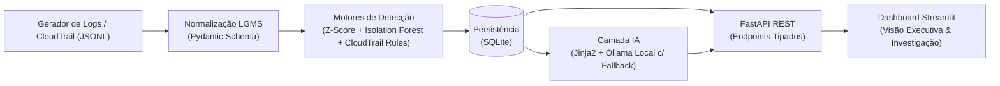

# SecOps Assistido — MãosNaTech

> **Plataforma Local e Inteligente de Triagem e Investigação de Alertas AWS CloudTrail com Custo Zero e IA Explicável**

[](https://www.python.org/)
[](https://fastapi.tiangolo.com/)
[](https://streamlit.io/)
[](https://ollama.ai/)
[](LICENSE)

---

## 1. Resumo Executivo & Problema Resolvido

Operações de Segurança em Nuvem (SecOps) sofrem rotineiramente com a **fadiga de alertas** provocada pelo volume massivo de eventos em trilhas de auditoria como o **AWS CloudTrail**. Centenas de alertas diários inundam analistas júnior e gerentes de segurança com informações descontextualizadas, gerando ruído operacional, tempo excessivo de triagem (MTTA) e risco elevado de incidentes críticos passarem despercebidos.

O **SecOps Assistido** resolve esse desafio por meio de uma abordagem moderna e 100% offline-first:
- **Detecção Híbrida de Ameaças:** Combina regras determinísticas de conformidade e segurança em nuvem com detecção estatística multivariada (**Z-Score**) e Machine Learning não supervisionado (**Isolation Forest**).
- **IA Local Explicável:** Gera relatórios analíticos, diagnósticos de causa-raiz e planos de contenção instantâneos utilizando LLMs locais (**Ollama / LLaMA 3.2**) guiados por templates determinísticos **Jinja2** (anti-alucinação).
- **Operação Offline e Custo Zero:** Arquitetura desacoplada e auto-hospedada que roda integralmente em estações de trabalho de analistas, sem faturamento em nuvem, garantindo soberania e privacidade absoluta dos dados.

---

## 2. Arquitetura Local

O fluxo de dados da solução é 100% desacoplado e executado inteiramente em ambiente local:



### Componentes do Fluxo:
1. **Ingestão & Sintetização:** Leitura de trilhas de auditoria AWS CloudTrail estruturadas em JSON Lines (JSONL).
2. **Normalização LGMS (Log General Management Schema):** Validação estrita e tipagem de campos canônicos via Pydantic.
3. **Motores de Detecção Híbridos:**
   - *Regras Heurísticas:* Detecção de ações de alto risco (ex: acesso root, evasão de CloudTrail, escalada de privilégios IAM).
   - *Z-Score:* Identificação de picos volumétricos anômalos de chamadas por identidade/serviço.
   - *Isolation Forest:* Agrupamento e isolamento de padrões anômalos multidimensionais sem supervisão prévia.
4. **Persistência SQLite:** Armazenamento relacional ultraleve e desacoplado, sem dependência de daemons de banco externos.
5. **Camada de Inteligência:** Síntese de incidentes com LLaMA local (via Ollama) com fallback automático e instantâneo para Jinja2 quando offline.
6. **API REST FastAPI:** Interface desacoplada com endpoints estruturados para consulta de métricas e alertas.
7. **Dashboard Streamlit:** Interface visual rica com métricas executivas, timelines de eventos e detalhes forenses.

---

## 3. Guia Rápido de Inicialização (< 5 minutos, Custo Zero)

Siga os passos abaixo para clonar, configurar e rodar o pipeline completo localmente em menos de 5 minutos.

### Pré-requisitos
- **Python 3.10+** instalado
- **Git** instalado
- *(Opcional)* **Ollama** instalado para contextualização via LLM local (o sistema funciona plenamente com Jinja2 caso o Ollama não esteja disponível).

---

### Passo 1: Clonar o Repositório e Configurar o Ambiente Virtual

```bash
# 1. Clonar o projeto
git clone https://github.com/maosnatech/secops-assistido.git
cd secops-assistido

# 2. Criar e ativar o ambiente virtual (venv)
# No Linux / macOS:
python3 -m venv .venv
source .venv/bin/activate

# No Windows (PowerShell):
python -m venv .venv
.\.venv\Scripts\Activate.ps1

# 3. Instalar as dependências
pip install --upgrade pip
pip install -r requirements.txt
# Ou instalar em modo editável:
pip install -e .
```

---

### Passo 2: Gerar Logs e Processar o Pipeline

Gere os eventos de log simulados do AWS CloudTrail e execute o pipeline de normalização e detecção:

```bash
python -m secops_core.pipeline
```
*Este comando normaliza os logs via LGMS, executa os motores de regras, Z-Score e Isolation Forest, persistindo os incidentes detectados no banco SQLite local.*

---

### Passo 3: Iniciar a API REST FastAPI

Em um terminal com o ambiente virtual ativo, suba a API:

```bash
uvicorn api.main:app --reload --port 8000
```
- Acesse a documentação interativa OpenAPI/Swagger: [http://localhost:8000/docs](http://localhost:8000/docs)
- Métricas e alertas disponíveis via endpoints `/alerts`, `/metrics`, etc.

---

### Passo 4: Subir o Painel Interativo Streamlit

Em um novo terminal (com o `.venv` ativado), inicie o dashboard:

```bash
streamlit run dashboard/app.py
```
- O painel abrirá automaticamente no navegador em: [http://localhost:8501](http://localhost:8501)
- Permite triagem visual, filtros por severidade, inspeção forense de payloads e contextualização via IA.

---

### Passo 5 (Opcional): Configurar o Ollama Local

Para habilitar resumos executivos gerados por inteligência artificial local:

```bash
# Baixar o modelo recomendado
ollama pull llama3.2

# Garantir que o serviço do Ollama esteja rodando
ollama serve
```

> **Fallback Resiliente:** Se o Ollama não estiver instalado ou estiver desligado, o sistema detecta a indisponibilidade automaticamente e aciona o motor determinístico baseado em templates Jinja2. **Nenhuma funcionalidade quebra e a análise técnica é entregue instantaneamente.**

---

### Executar a Suíte de Testes Automatizados

Para validar toda a integridade do código, schemas de dados e modelos estatísticos:

```bash
pytest -v
```

---

## 4. Contribuição por Papel da Equipe (Mãos na Tech)

O projeto foi construído colaborativamente simulando um time multidisciplinar de excelência em Engenharia e Segurança de Nuvem:

| Papel | Responsabilidades & Entregas na Solução |
| :--- | :--- |
| **Arquiteto de Soluções / Cloud** | Desenho da arquitetura desacoplada e agnóstica; padronização do Log General Management Schema (LGMS); estratégia de resiliência *offline-first* e garantia de custo zero de infraestrutura. |
| **Cloud Practitioner / SecOps** | Mapeamento dos eventos de alto risco no AWS CloudTrail (`ConsoleLogin`, `StopLogging`, `CreateAccessKey`, adulteração de trilhas e uso da conta Root); definição de matrizes de severidade e playbooks de mitigação. |
| **Cientista de Dados / IA** | Engenharia de features temporais e comportamentais; implementação dos modelos de detecção estatística (**Z-Score**) e aprendizado não supervisionado (**Isolation Forest**); concepção de templates Jinja2 estruturados com engenharia de prompt anti-alucinação. |
| **Desenvolvedor Backend** | Construção do pipeline modular em Python; camada de persistência com SQLite; implementação da API REST assíncrona com **FastAPI** e validação estrita com **Pydantic**. |
| **Infraestrutura / Frontend** | Desenvolvimento do Dashboard interativo em **Streamlit** (visão executiva para gestores e modo de investigação forense para analistas); suíte de testes com **pytest** e documentação operacional. |

---

## 5. Checklist de Governança, Menor Privilégio e Custo Zero (MãosNaTech)

Antes da publicação e liberação oficial, a solução foi validada conforme os 5 pilares do checklist MãosNaTech:

| Item | Pilar de Governança | Status | Evidência / Comprovação Técnica |
| :---: | :--- | :---: | :--- |
| **1** | **Custo Zero Comprovado** | `[x]` Concluído | **100% Execução Local:** SQLite, Scikit-Learn, FastAPI, Streamlit e Ollama/Jinja2. Zero dependência de serviços de nuvem pagos, gateways proprietários ou cobranças de faturamento. |
| **2** | **Segurança e Credenciais (Zero Secrets)** | `[x]` Concluído | **Zero Segredos Versionados:** Nenhuma chave AWS (Access Key / Secret Key), token ou arquivo `.env` real commitado no repositório. O arquivo `.gitignore` protege estritamente dados sensíveis e credenciais locais. |
| **3** | **Menor Privilégio e Privacidade de Dados** | `[x]` Concluído | **Processamento Local & Soberania:** Todos os logs e trilhas de auditoria permanecem na máquina local. Nenhum IP, identidade IAM, ARN ou hash é enviado para APIs de terceiros. |
| **4** | **Resiliência e Determinismo** | `[x]` Concluído | **Fallback Transparente:** O mecanismo de fallback via Jinja2 garante análise técnica padronizada e enriquecimento de alertas mesmo em ambientes sem GPU ou com o servidor Ollama desligado. |
| **5** | **Qualidade e Reprodutibilidade** | `[x]` Concluído | **Suíte Automatizada:** Cobertura de testes unitários e de integração com `pytest` utilizando bancos SQLite temporários em memória; setup completo testado e reproduzível em menos de 5 minutos. |

---

## Licença

Distribuído sob a licença MIT. Consulte `LICENSE` para obter mais detalhes.
